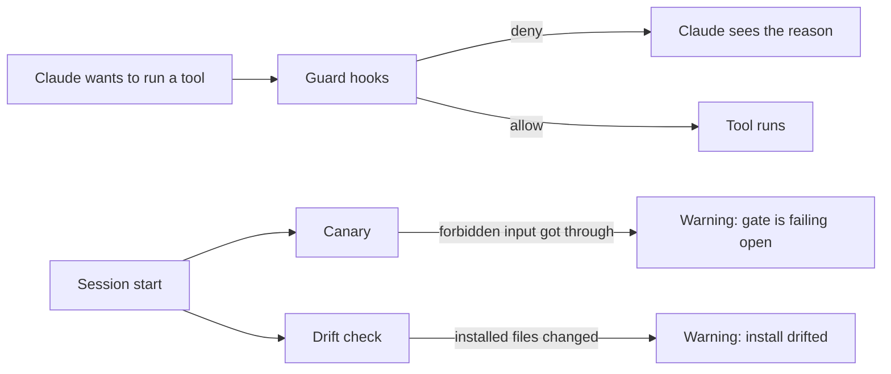

# Deadbolt

**Guard hooks for Claude Code that say no, and a canary that tells you when they stop.**

A rule in `CLAUDE.md` is a request. The model follows it most of the time. Then a long session or a vague prompt comes along, and it doesn't, and you find out afterwards.

A hook runs on every tool call and can deny it. Deadbolt is a small set of working hooks built on one idea: if a rule matters, name the file that enforces it. If you can't, the rule is a hope.

## Who it is for

You use Claude Code on your own machine, often with auto-approve or long unattended runs. You want a few things to be impossible for the model, not just discouraged: force pushes, deleting your home folder, printing a secret. You also want to know when that protection breaks.

It is not for teams that need a sandbox or a policy server. See [what this is not](#what-this-is-not).

## What it looks like

Ask Claude to run `git push --force origin main`. The guard answers the tool call before it runs:

```json
{"hookSpecificOutput":{"hookEventName":"PreToolUse","permissionDecision":"deny","permissionDecisionReason":"Blocked: git push --force (deadbolt guard. Run it yourself in a real terminal if you truly need it)"}}
```

Claude sees the reason and stops. You can still run the command yourself in a normal terminal. The block applies to the model only.

## Why there is a canary

A guard that broke looks exactly like a guard with nothing to block. Both stay silent.

This happened in the setup Deadbolt came from. A fixed guard was quietly replaced by an older broken copy. For the next session it failed 23 of its own 120 test cases, and nothing reported it. So Deadbolt checks itself. At every session start, the canary sends real forbidden inputs through the guards and warns you if any of them gets through.

## How it fits together



## What you get

| Part | What it does |
|---|---|
| **Guards** | Deny force pushes, skipped git hooks, home or root deletes, printed secrets, reads of secret files, memory-file wipes, and deploys to an unconfirmed target |
| **Canary** | At every session start, sends real forbidden inputs through the guards and says so if one gets through |
| **Drift checks** | Compare what is installed with what was installed. Catch retired facts in docs, and rules that name an enforcing file that no longer exists |
| **Plan gates** | Pass or fail a plan on tagged steps, stated scope and stated verification |
| **`/delegate`** (optional) | Read-only second opinions from a non-Anthropic model |

Every rule and the file that enforces it is listed in [docs/ENFORCEMENT.md](docs/ENFORCEMENT.md). A script checks that table too.

## Prerequisites

| Need | Version |
|---|---|
| OS | Windows 11 with Git Bash, or Linux. See "Tested on" below |
| bash | 4.4 or newer. macOS ships 3.2, so run `brew install bash` and put it first on PATH |
| jq | Any recent version. Required |
| sha256sum or shasum | Required, for the drift check |
| Claude Code | Tested on 2.1.316. Older versions are untested |

The guards use bash features that bash 3.2 lacks, so the installer refuses to run on it. A guard that crashes cannot deny.

## Install

```
git clone https://github.com/argaur/deadbolt.git
cd deadbolt
bash install.sh --dry-run    # see what would change
bash install.sh              # core
```

Add `--with-delegate` for the optional lane in [docs/delegate.md](docs/delegate.md).

The installer:

- puts everything in `~/.claude/deadbolt/`, apart from the model-router skill and, with `--with-delegate`, the `/delegate` command and its agent;
- merges hooks into your `settings.json`, keeps everything else in it, and writes a timestamped backup first;
- never overwrites a file of yours;
- writes a manifest for the drift check;
- runs the canary, and stops with an error if a guard does not deny.

It is safe to run twice. Start a new Claude Code session to load the hooks.

To wire it by hand instead, [examples/settings.json](examples/settings.json) is a complete settings file.

To remove it, run `bash install.sh --uninstall`. Your own settings and hooks stay.

## Try the canary

Run this in your own terminal, not through Claude. It swaps the guard for one that allows everything, runs the canary, then puts the guard back:

```
cp ~/.claude/deadbolt/hooks/pre-tool-use-guard.sh /tmp/guard.bak
printf '#!/usr/bin/env bash\nexit 0\n' > ~/.claude/deadbolt/hooks/pre-tool-use-guard.sh
bash ~/.claude/deadbolt/hooks/hook-canary.sh
cp /tmp/guard.bak ~/.claude/deadbolt/hooks/pre-tool-use-guard.sh
```

The canary reports `GATE IS FAILING OPEN`.

## What this is not

It is not a sandbox. The guards stop accidents and the common shapes of a bad command. A determined process can get past them, and [docs/guards.md](docs/guards.md) lists the known ways. Keep real secrets out of reach, and keep your own backups.

## Status

Early, and maintained by one person. The guards come from a personal setup where they run on every tool call. Deadbolt has had no outside users yet, so expect rough edges on machines unlike that one. Issues with a failing command and your OS are the most useful report.

## Docs

- [The guards, and their known limits](docs/guards.md)
- [Canary and drift checks](docs/drift.md)
- [Plan gates](docs/plan-gates.md)
- [Delegation (optional)](docs/delegate.md)
- [Enforcement table](docs/ENFORCEMENT.md)

## Tests

```
bash tests/guards-test.sh     # adversarial inputs to each guard
bash tests/clean-room.sh      # install into an empty temp HOME, then sabotage it
```

`clean-room.sh` uses a fresh temp HOME, fake env vars and fake backends. It fails if your real `~/.claude/settings.json` changed while it ran. The full run takes several minutes on Windows, because it starts hundreds of bash processes.

**Tested on:** Windows 11 with Git Bash (bash 5.2) and Ubuntu on WSL. macOS is untested.

## License

MIT. See [LICENSE](LICENSE).
